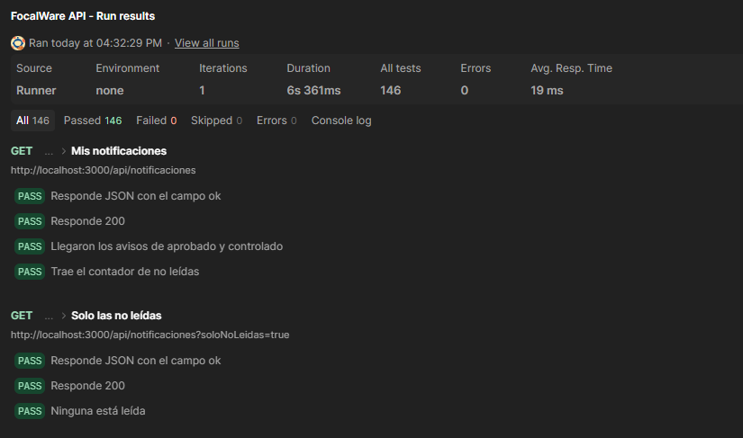
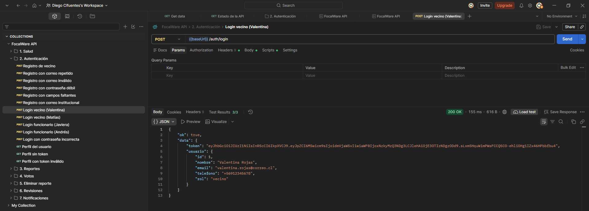
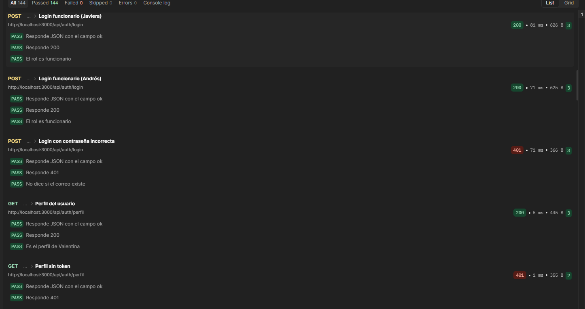
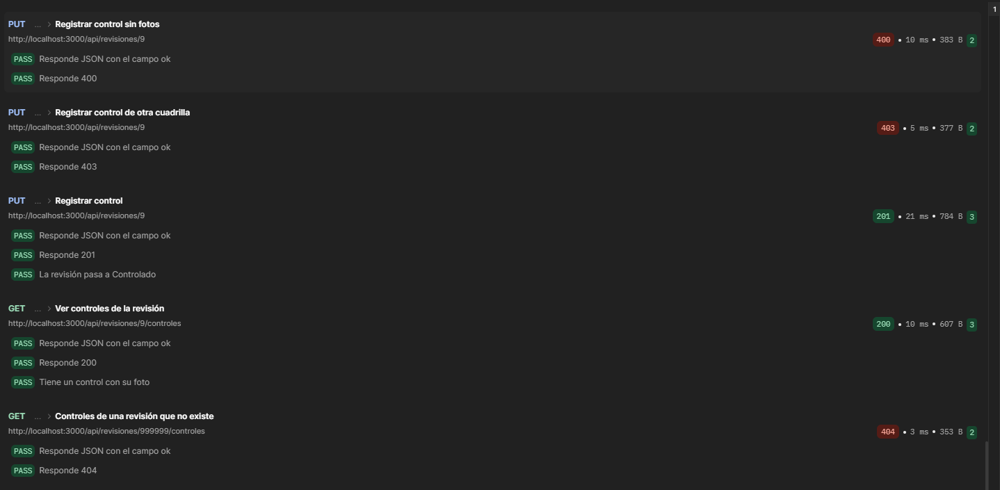
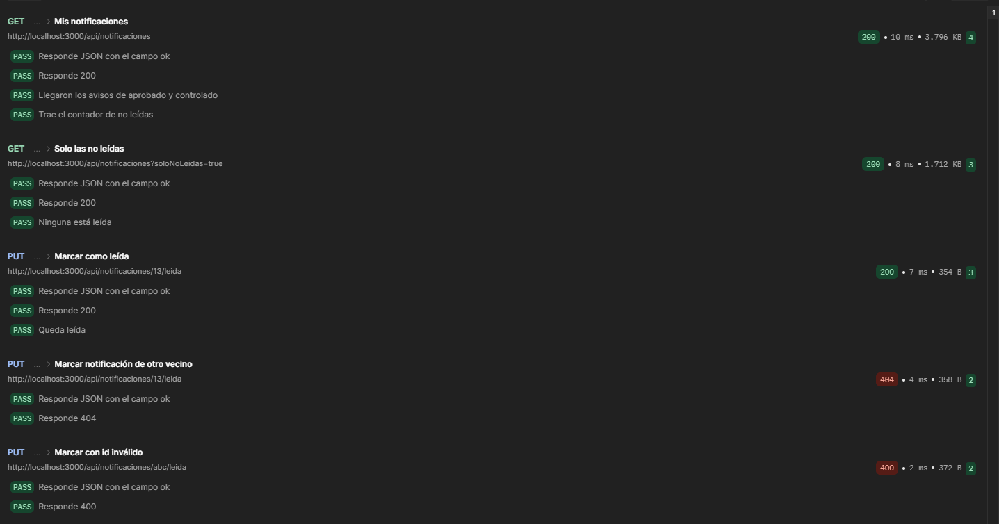

# EP 2.7 · Endpoints y pruebas de la API

**FocalWare** · Priorización de limpieza por riesgo de incendio en las quebradas de Valparaíso

[← Volver al README](../README.md)

---

Este documento explica todos los endpoints de la API de FocalWare: qué hacen, quién los puede usar, qué datos reciben, qué responden y qué errores pueden dar. Al final están las pruebas que hicimos en Postman y sus resultados.

La colección de Postman está en [`backend/postman/FocalWare.postman_collection.json`](../backend/postman/FocalWare.postman_collection.json).

## 1. Cómo correr las pruebas

**Antes de empezar:** la base de datos tiene que estar con los datos de prueba y la API corriendo en `http://localhost:3000`.

```bash
docker compose up -d db
cd backend
npm start
```

Se usa `npm start` y no `npm run dev`, porque el modo de desarrollo reinicia la API cuando detecta un cambio en un archivo y, si eso pasa en medio de la corrida, las peticiones siguientes fallan.

### 1.1 En Postman

1. Abrir Postman, apretar **Ctrl + O** (Import) y arrastrar el archivo `backend/postman/FocalWare.postman_collection.json`.
2. Para la prueba que sube una foto, ir al engranaje > **App settings > General > Working directory** y elegir la carpeta `backend/postman`. Ahí está `foto-prueba.png`.
3. Abrir la colección **FocalWare API**, apretar **Run** y después **Start run**.

Las pruebas **se corren en orden**: los logins guardan los tokens y los reportes que se crean se usan en las carpetas siguientes. Se pueden correr las veces que se quiera, porque cada corrida usa un correo y una ubicación nuevos.

### 1.2 Por consola (opcional)

Con [Newman](https://www.npmjs.com/package/newman), la versión de Postman para la terminal, desde la carpeta `backend/postman`:

```bash
npx newman run FocalWare.postman_collection.json --working-dir .
```

## 2. Cómo responde la API

Todas las respuestas son JSON y tienen el mismo formato.

**Cuando todo sale bien:**

```json
{
  "ok": true,
  "data": { "...": "lo que se pidió" }
}
```

**Cuando hay un error:**

```json
{
  "ok": false,
  "error": "Mensaje que explica qué pasó"
}
```

**Códigos HTTP que usa la API:**

| Código | Significado | Ejemplo |
|---|---|---|
| `200` | Todo bien | Listar reportes |
| `201` | Se creó algo | Crear un reporte o registrarse |
| `400` | Faltan datos o vienen mal | Un correo sin `@` |
| `401` | No hay sesión o el token no sirve | Pedir el perfil sin token |
| `403` | Hay sesión, pero no tiene permiso | Un vecino intenta revisar un reporte |
| `404` | No existe | Un reporte que fue borrado |
| `409` | Choca con algo que ya existe | Votar dos veces el mismo reporte |
| `500` | Error interno | El mensaje no muestra detalles del servidor |

## 3. Autenticación

Al iniciar sesión, la API entrega un **token JWT**. Ese token se manda en cada petición protegida, en la cabecera:

```
Authorization: Bearer <token>
```

- El token dura **15 minutos** (`JWT_EXPIRACION` en el `.env`). Después la API responde `401` con "La sesión expiró, vuelve a iniciar sesión".
- El token guarda el **id** y el **rol** del usuario (`vecino` o `funcionario`). Con el rol se decide quién puede usar cada ruta.

**Usuarios de prueba** (de `backend/database/datos_prueba.sql`, contraseña `Clave123`):

| Rol | Correo | Detalle |
|---|---|---|
| Vecino | `valentina.rojas@correo.cl` | |
| Vecino | `matias.fuentes@correo.cl` | |
| Funcionario | `javiera.munoz@focalware.cl` | Cuadrillas Cerros y Quebradas |
| Funcionario | `andres.perez@focalware.cl` | Cuadrilla Norte |

## 4. Lista de endpoints

Todas las rutas empiezan con `http://localhost:3000/api`.

| # | Método | Ruta | Acceso | Qué hace |
|---|---|---|---|---|
| 1 | `GET` | `/salud` | Público | Revisa que la API y la base estén funcionando |
| 2 | `POST` | `/auth/registro` | Público | Crea una cuenta de vecino |
| 3 | `POST` | `/auth/login` | Público | Inicia sesión y entrega el token |
| 4 | `GET` | `/auth/perfil` | Con sesión | Datos del usuario que inició sesión |
| 5 | `GET` | `/reportes` | Público | Lista los reportes del mapa |
| 6 | `GET` | `/reportes/:id` | Público | Detalle de un reporte |
| 7 | `GET` | `/reportes/mios` | Vecino | Reportes del vecino que inició sesión |
| 8 | `POST` | `/reportes` | Vecino | Crea un reporte con hasta 5 fotos |
| 9 | `PUT` | `/reportes/:id` | Vecino dueño | Modifica un reporte que aún no se revisa |
| 10 | `DELETE` | `/reportes/:id` | Vecino dueño | Elimina un reporte que aún no se revisa |
| 11 | `POST` | `/reportes/:id/votos` | Vecino | Apoya un reporte de otro vecino |
| 12 | `DELETE` | `/reportes/:id/votos` | Vecino | Quita el apoyo |
| 13 | `GET` | `/revisiones/cola` | Funcionario | Reportes que esperan revisión, del más riesgoso al menos |
| 14 | `POST` | `/reportes/:id/revision` | Funcionario | Aprueba, rechaza o deja en atención un reporte |
| 15 | `PUT` | `/revisiones/:id` | Funcionario de la cuadrilla | Registra el control (cierre del trabajo) con fotos |
| 16 | `GET` | `/revisiones/:id/controles` | Funcionario de la cuadrilla | Controles de una revisión con sus fotos |
| 17 | `GET` | `/notificaciones` | Vecino | Notificaciones del vecino |
| 18 | `PUT` | `/notificaciones/:id/leida` | Vecino | Marca una notificación como leída |

En las rutas, `:id` es el número del reporte, de la revisión o de la notificación. Si no es un número entero, la API responde `400`.

## 5. Detalle de cada endpoint

### 5.1 Salud

#### 1. `GET /salud`

Sirve para saber si la API está viva y conectada a la base de datos.

**Respuesta `200`:**

```json
{
  "ok": true,
  "data": { "api": "funcionando", "baseDeDatos": "conectada", "hora": "2026-10-18T16:21:42.764Z" }
}
```

Si se pide una ruta que no existe, la API responde `404` con `"Ruta no encontrada"`.

### 5.2 Autenticación

#### 2. `POST /auth/registro`

Crea una cuenta de **vecino**. Las cuentas de funcionario (`@focalware.cl`) las entrega la municipalidad.

**Body (JSON):**

| Campo | Tipo | Obligatorio | Regla |
|---|---|---|---|
| `nombre` | texto | Sí | |
| `email` | texto | Sí | Formato `nombre@dominio.cl`. No puede ser `@focalware.cl` |
| `password` | texto | Sí | Mínimo 8 caracteres, con mayúscula, minúscula y número |

```json
{ "nombre": "Vecino de Prueba", "email": "vecino@correo.cl", "password": "Clave1234" }
```

**Respuesta `201`:** el token y los datos del usuario, igual que el login. Nunca devuelve la contraseña.

**Errores:**

| Código | Cuándo |
|---|---|
| `400` | Faltan campos, el correo no es válido, la contraseña es débil o el correo es `@focalware.cl` |
| `409` | Ya existe una cuenta con ese correo |

#### 3. `POST /auth/login`

Revisa el correo y la contraseña. Busca primero en vecinos y después en funcionarios para saber el rol.

**Body (JSON):**

```json
{ "email": "valentina.rojas@correo.cl", "password": "Clave123" }
```

**Respuesta `200`:**

```json
{
  "ok": true,
  "data": {
    "token": "eyJhbGciOiJIUzI1NiIsInR5cCI6IkpXVCJ9...",
    "usuario": {
      "id": 1,
      "nombre": "Valentina Rojas",
      "email": "valentina.rojas@correo.cl",
      "telefono": "+56912345678",
      "rol": "vecino"
    }
  }
}
```

**Errores:**

| Código | Cuándo |
|---|---|
| `400` | Falta el correo o la contraseña |
| `401` | `"Correo o contraseña incorrectos"`. Es el mismo mensaje si el correo no existe, para no revelar qué correos están registrados |

#### 4. `GET /auth/perfil`

**Acceso:** cualquier usuario con sesión. Devuelve el mismo objeto `usuario` del login.

**Errores:**

| Código | Cuándo |
|---|---|
| `401` | No hay token, el token es inválido o expiró |
| `404` | El usuario del token ya no existe |

### 5.3 Reportes

#### 5. `GET /reportes`

Lista los reportes para el mapa. No muestra los rechazados ni los controlados que se crearon hace más de un mes. Si viene token de vecino, cada reporte dice si ese vecino ya lo apoyó (`miVoto`). **Nunca muestra quién creó el reporte.**

**Filtros opcionales (query):** `sector`, `categoria` y `estado`. Ejemplo: `/reportes?estado=Aprobado`.

**Respuesta `200`:** `{ "ok": true, "data": { "reportes": [ ... ] } }`, con cada reporte en el mismo formato del detalle.

#### 6. `GET /reportes/:id`

Detalle de un reporte, con fotos, clima y el avance de su gestión. El correo y el nombre del vecino solo los ven el dueño y los funcionarios.

**Respuesta `200` (resumida):**

```json
{
  "ok": true,
  "data": {
    "reporte": {
      "id": "1",
      "nombre": "Acumulación de basura en quebrada",
      "sector": "Cerro Cordillera",
      "categoria": "Microbasural",
      "estado": "En atención",
      "fecha": "2026-09-02",
      "riesgo": 86,
      "votos": 2,
      "miVoto": false,
      "esMio": false,
      "latitud": -33.0418,
      "longitud": -71.6335,
      "volumen": "Muy grande (un camión)",
      "distanciaViviendas": "Menos de 10 m",
      "imagenes": [],
      "clima": { "temperatura": 24.5, "humedad": 28, "viento": 32, "condicion": "Despejado" },
      "gestion": {
        "aprobacion": {
          "cuadrilla": "Cuadrilla Cerros (DIMAO)",
          "fechaAtencion": "2026-09-10",
          "funcionario": "Javiera Muñoz"
        }
      }
    }
  }
}
```

**Errores:** `400` si el id no es un número y `404` si el reporte no existe.

#### 7. `GET /reportes/mios`

**Acceso:** solo vecinos. Lista los reportes que creó el vecino que inició sesión, en el mismo formato.

**Errores:** `401` sin sesión y `403` si es un funcionario.

#### 8. `POST /reportes`

**Acceso:** solo vecinos. Se manda como **form-data** porque puede llevar fotos.

| Campo | Tipo | Obligatorio | Regla |
|---|---|---|---|
| `nombre` | texto | Sí | Título, máximo 150 caracteres |
| `descripcion` | texto | No | |
| `categoria` | texto | Sí | Por ejemplo `Microbasural` |
| `volumen` | texto | Sí | Por ejemplo `Mediano (un auto)` |
| `sector` | texto | Sí | Máximo 100 caracteres |
| `latitud` | número | Sí | Entre -90 y 90 |
| `longitud` | número | Sí | Entre -180 y 180 |
| `distanciaViviendas` | texto | No | `Menos de 10 m`, `Entre 10 y 50 m`, `Entre 50 y 100 m` o `Más de 100 m` |
| `riesgo` | número | No | Entre 0 y 100 |
| `fotos` | archivos | No | Hasta 5 fotos JPG, PNG o WEBP de máximo 5 MB cada una |

**Respuesta `201`:** `{ "ok": true, "data": { "reporte": { ... } } }`, con el reporte en estado `Pendiente`.

**Errores:**

| Código | Cuándo |
|---|---|
| `400` | Falta un dato obligatorio, un dato no es válido o las fotos no cumplen las reglas |
| `401` | No hay sesión |
| `403` | Es un funcionario |
| `409` | `"Ya existe un antecedente previo de este reporte"`: hay otro reporte de la misma categoría a menos de 50 m |

#### 9. `PUT /reportes/:id`

**Acceso:** solo el vecino que creó el reporte, y solo mientras el municipio no lo haya revisado. Se manda como **form-data** y solo con los campos que se quieren cambiar (los mismos del punto 8).

Para cambiar las fotos se manda `imagenesActuales` (la lista en JSON de las fotos que se quedan) y las fotos nuevas en `fotos`. El reporte tiene que quedar con al menos una foto.

**Respuesta `200`:** el reporte actualizado.

**Errores:**

| Código | Cuándo |
|---|---|
| `400` | Un dato no es válido o el reporte ya fue revisado |
| `401` | No hay sesión |
| `403` | El reporte es de otro vecino, o es un funcionario |
| `404` | El reporte no existe |

#### 10. `DELETE /reportes/:id`

**Acceso:** solo el vecino que creó el reporte, y solo mientras no se haya revisado. Borra también sus fotos y votos.

**Respuesta `200`:** `{ "ok": true, "data": { "eliminado": true } }`

**Errores:** `400` si ya fue revisado, `403` si es de otro vecino y `404` si no existe.

### 5.4 Votos

#### 11. `POST /reportes/:id/votos`

**Acceso:** solo vecinos. Sirve para apoyar el reporte de otro vecino.

**Respuesta `201`:** el total de votos del reporte.

```json
{ "ok": true, "data": { "votos": 1 } }
```

**Errores:**

| Código | Cuándo |
|---|---|
| `400` | Es su propio reporte, o el reporte fue rechazado |
| `403` | Es un funcionario |
| `404` | El reporte no existe |
| `409` | `"Ya apoyaste este reporte"` |

#### 12. `DELETE /reportes/:id/votos`

**Acceso:** solo vecinos. Quita el apoyo. Si el vecino no había votado, no es error.

**Respuesta `200`:** `{ "ok": true, "data": { "votos": 0 } }`

**Errores:** `403` si es un funcionario y `404` si el reporte no existe.

### 5.5 Revisiones (gestión municipal)

#### 13. `GET /revisiones/cola`

**Acceso:** solo funcionarios. Entrega los reportes que todavía no tienen revisión, ordenados por índice de riesgo de mayor a menor.

**Respuesta `200`:** `{ "ok": true, "data": [ ... ] }`

**Errores:** `401` sin sesión y `403` si es un vecino.

#### 14. `POST /reportes/:id/revision`

**Acceso:** solo funcionarios. Guarda la revisión del reporte y, en la misma operación, el historial (`log`) y la notificación al vecino.

**Body (JSON):**

| Campo | Tipo | Obligatorio | Regla |
|---|---|---|---|
| `estado` | texto | Sí | `Aprobado`, `Rechazado`, `En atención` o `Controlado` |
| `motivo` | texto | Solo al rechazar | Por qué se rechaza |
| `idCuadrilla` | número | No | Cuadrilla que atiende. También se puede mandar el nombre en `cuadrilla` |
| `detalle` | texto | No | Detalle de la aprobación |
| `fechaAtencion` | fecha | No | Si no viene, se usa la fecha actual |

```json
{ "estado": "Aprobado", "idCuadrilla": 1, "detalle": "Retiro de basura con la cuadrilla de cerros." }
```

**Respuesta `201`:** la revisión creada, con su `idRevision` y su `estado`.

**Errores:**

| Código | Cuándo |
|---|---|
| `400` | Falta el estado, el estado no es válido, falta el motivo al rechazar, la cuadrilla no existe o la fecha no es válida |
| `403` | Es un vecino |
| `404` | El reporte no existe |
| `409` | `"El reporte existe y ya ha sido revisado"` |

#### 15. `PUT /revisiones/:id`

**Acceso:** solo un funcionario que **pertenece a la cuadrilla** de esa revisión. Registra el control: la revisión pasa a `Controlado`, se guarda el historial y se avisa al vecino. Se manda como **form-data**.

| Campo | Tipo | Obligatorio | Regla |
|---|---|---|---|
| `detalle` | texto | No | Qué se hizo en terreno |
| `fotos` | archivos | Sí | Entre 1 y 5 fotos de evidencia |

**Respuesta `201`:** el control creado y la revisión con estado `Controlado`.

**Errores:**

| Código | Cuándo |
|---|---|
| `400` | No viene ninguna foto |
| `403` | Es un vecino, o el funcionario no es de esa cuadrilla |
| `404` | La revisión no existe |
| `409` | La revisión no tiene cuadrilla, o no está `Aprobado` ni `En atención` |

#### 16. `GET /revisiones/:id/controles`

**Acceso:** el mismo del punto 15. Lista los controles de la revisión con sus fotos.

**Respuesta `200`:** `{ "ok": true, "data": { "controles": [ ... ] } }`

**Errores:** `403` si no es de la cuadrilla y `404` si la revisión no existe.

### 5.6 Notificaciones

#### 17. `GET /notificaciones`

**Acceso:** solo vecinos. Entrega las últimas 50 notificaciones del vecino y cuántas no ha leído.

**Filtro opcional (query):** `soloNoLeidas=true`.

**Respuesta `200`:**

```json
{
  "ok": true,
  "data": {
    "notificaciones": [
      {
        "id": 6,
        "mensaje": "Tu reporte \"Colchones y muebles en quebrada\" fue rechazado.",
        "estado": "Rechazado",
        "leida": true,
        "fecha": "2026-09-29T11:00:00.000Z",
        "reporte": { "id": 7, "titulo": "Colchones y muebles en quebrada" },
        "fechas": {
          "creacion": "2026-09-28T13:30:00.000Z",
          "aprobacion": null,
          "rechazo": "2026-09-29T11:00:00.000Z",
          "control": null
        }
      }
    ],
    "noLeidas": 1
  }
}
```

**Errores:** `401` sin sesión y `403` si es un funcionario.

#### 18. `PUT /notificaciones/:id/leida`

**Acceso:** solo vecinos, y solo con sus propias notificaciones.

**Respuesta `200`:** `{ "ok": true, "data": { "idNotificacion": 6, "leida": true } }`

**Errores:**

| Código | Cuándo |
|---|---|
| `400` | El id no es un número |
| `404` | La notificación no existe **o es de otro vecino**. Se responde igual en los dos casos para no revelar que existe |

## 6. Evidencia de las pruebas

La colección tiene **58 peticiones en 7 carpetas**. Cada petición revisa el código HTTP y que la respuesta tenga el formato `{ ok, data }` o `{ ok, error }`. Muchas revisan además el contenido, por ejemplo que el login no devuelva la contraseña o que un visitante no vea el correo del vecino.

Se probaron los casos que funcionan y también los de error: sin sesión (`401`), rol equivocado (`403`), datos inválidos (`400`), recursos que no existen (`404`) y datos repetidos (`409`).

**Resultado de la corrida en el Collection Runner de Postman (18/10/2026):**

| Carpeta | Peticiones | Comprobaciones | Fallas |
|---|---|---|---|
| 1. Salud | 2 | 6 | 0 |
| 2. Autenticación | 14 | 37 | 0 |
| 3. Reportes | 14 | 36 | 0 |
| 4. Votos | 5 | 12 | 0 |
| 5. Eliminar reporte | 3 | 6 | 0 |
| 6. Revisiones | 14 | 33 | 0 |
| 7. Notificaciones | 6 | 16 | 0 |
| **Total** | **58** | **146** | **0** |

### 6.1 Capturas

**Resumen del Runner:** 146 comprobaciones pasadas, 0 fallidas y 0 errores.



**Respuesta completa de un login:** `POST /auth/login` responde `200 OK` con el token y los datos del usuario, y pasan sus 3 pruebas.



**Autenticación:** los logins de vecino y funcionario responden `200` con el rol correcto. La contraseña incorrecta responde `401` sin decir si el correo existe, y el perfil sin token responde `401`.



**Revisiones:** rechazar sin motivo da `400`, un vecino que intenta revisar recibe `403`, un reporte que no existe da `404`, aprobar responde `201` y revisar dos veces el mismo reporte da `409`.



**Notificaciones:** el vecino recibe los avisos de su reporte aprobado y controlado, y puede marcarlos como leídos. Otro vecino no puede marcarlos (`404`) y un id inválido da `400`.



**Qué queda en la base después de correr las pruebas:** el reporte de la carpeta 3 se borra al final, pero cada corrida deja un vecino nuevo y un reporte controlado de prueba (carpeta 6). Para volver a la base limpia:

```bash
docker compose down -v
docker compose up -d db
```

Después hay que volver a crear las tablas y cargar los datos de prueba, como dice el README.
