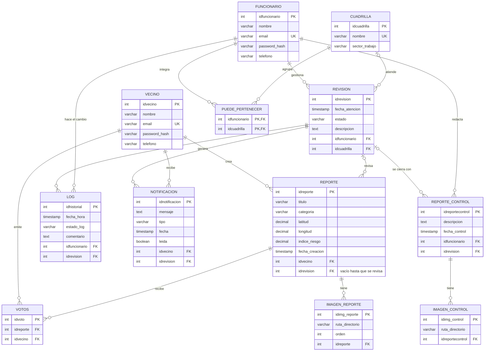
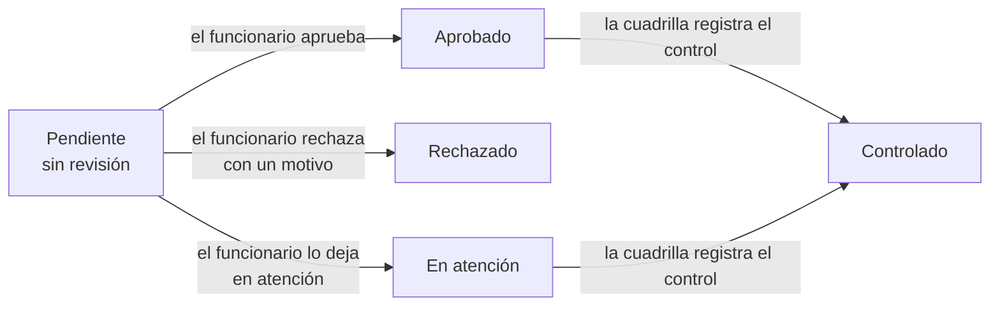

# Base de Datos · FocalWare

**FocalWare** · Priorización de limpieza por riesgo de incendio en las quebradas de Valparaíso

[← Volver al README](../README.md)

---

Este documento explica cómo está armada la base de datos de FocalWare: qué tablas tiene, qué guarda cada una, cómo se conectan entre ellas y qué pasa en la base cuando un vecino o un funcionario usa la app.

**Herramientas usadas:**

| Herramienta | Para qué la usamos |
|---|---|
| **ERDPlus** | Dibujar el Diagrama Entidad-Relación (modelo conceptual) |
| **PostgreSQL 16** | El motor de base de datos donde se guarda todo |
| **Prisma 7** | El ORM: deja que el backend lea y guarde datos sin escribir SQL a mano |
| **Docker** | Levantar PostgreSQL igual en el computador de todos |

## 1. Cómo levantar la base

**Con Docker (recomendado):**

```bash
docker compose up -d db
```

La base queda en `localhost:5434` (dentro de Docker usa el puerto 5432). El puerto 5434 es para no chocar con un PostgreSQL que ya tengas instalado.

**A mano, sin Docker:**

```bash
psql -U postgres -h localhost -f backend/database/focalware.sql
```

Ese archivo crea la base `focalware`, las tablas y al final carga los datos de prueba de `datos_prueba.sql`.

> **Importante:** la fuente de verdad es `backend/prisma/schema.prisma`. El archivo `focalware.sql` es una copia del mismo esquema para montar la base a mano. Si se cambia uno, hay que cambiar el otro.

## 2. Diagrama de la base

Las tablas con sus llaves. Las líneas muestran cuántos registros de una tabla se conectan con la otra.



**Cómo leer las líneas:** `||` es "exactamente uno", `|o` es "cero o uno" y `o{` es "cero o muchos".

## 3. Tablas y atributos

Las tablas se agrupan en tres partes: **las personas**, **los reportes del vecino** y **la gestión municipal**.

**Llaves:** **PK** es la llave primaria (el identificador de la fila), **FK** es una llave foránea (apunta a otra tabla) y **UQ** significa que el valor no se puede repetir.

### 3.1 Las personas

#### Vecino
> Ciudadano que crea reportes, vota por los reportes de otros y recibe notificaciones.

| Atributo | Tipo | Llave | Descripción |
| :--- | :--- | :---: | :--- |
| `idvecino` | SERIAL | **PK** | Identificador del vecino. |
| `nombre` | VARCHAR(100) | | Nombre completo. |
| `email` | VARCHAR(150) | **UQ** | Correo para iniciar sesión. No se puede repetir. |
| `password_hash` | VARCHAR(255) | | Contraseña encriptada con bcrypt. Nunca se guarda la contraseña real. |
| `telefono` | VARCHAR(20) | | Número de contacto *(opcional)*. |

#### Funcionario
> Trabajador municipal que revisa los reportes, forma parte de cuadrillas y registra los controles en terreno.

| Atributo | Tipo | Llave | Descripción |
| :--- | :--- | :---: | :--- |
| `idfuncionario` | SERIAL | **PK** | Identificador del funcionario. |
| `nombre` | VARCHAR(100) | | Nombre completo. |
| `email` | VARCHAR(150) | **UQ** | Correo institucional para iniciar sesión. No se puede repetir. |
| `password_hash` | VARCHAR(255) | | Contraseña encriptada con bcrypt. |
| `telefono` | VARCHAR(20) | | Número de contacto *(opcional)*. |

#### Cuadrilla
> Equipo de trabajo en terreno que atiende los reportes aprobados.

| Atributo | Tipo | Llave | Descripción |
| :--- | :--- | :---: | :--- |
| `idcuadrilla` | SERIAL | **PK** | Identificador de la cuadrilla. |
| `nombre` | VARCHAR(100) | **UQ** | Nombre del equipo, por ejemplo "Cuadrilla Quebradas (OMZ)". No se puede repetir. |
| `sector_trabajo` | VARCHAR(100) | | Zona de Valparaíso donde trabaja *(opcional)*. |

#### Puede_Pertenecer
> Tabla intermedia: une funcionarios con cuadrillas, porque un funcionario puede estar en varias cuadrillas y una cuadrilla tiene varios funcionarios.

| Atributo | Tipo | Llave | Descripción |
| :--- | :--- | :---: | :--- |
| `idfuncionario` | INTEGER | **PK / FK** | Funcionario que pertenece a la cuadrilla. |
| `idcuadrilla` | INTEGER | **PK / FK** | Cuadrilla a la que pertenece. |

La llave primaria son las dos columnas juntas, así un funcionario no queda dos veces en la misma cuadrilla.

### 3.2 Los reportes del vecino

#### Reporte
> El aviso principal de la app: un foco de basura o maleza en una quebrada, con su ubicación, el clima de ese momento y su índice de riesgo.

| Atributo | Tipo | Llave | Descripción |
| :--- | :--- | :---: | :--- |
| `idreporte` | SERIAL | **PK** | Identificador del reporte. |
| `titulo` | VARCHAR(150) | | Resumen corto del problema. |
| `descripcion` | TEXT | | Detalle escrito por el vecino *(opcional)*. |
| `categoria` | VARCHAR(50) | | Tipo de problema, por ejemplo basural o maleza. |
| `tamano` | VARCHAR(30) | | Volumen estimado del foco. |
| `sector` | VARCHAR(100) | | Cerro o zona donde está. |
| `direccion` | VARCHAR(200) | | Calle o punto de referencia *(opcional)*. |
| `latitud` | NUMERIC(9,6) | | Coordenada GPS. |
| `longitud` | NUMERIC(9,6) | | Coordenada GPS. |
| `distancia_a_casas` | NUMERIC(8,2) | | Distancia en metros a las viviendas más cercanas *(opcional)*. |
| `indice_riesgo` | NUMERIC(5,2) | | Riesgo calculado por la app. Con este número se ordena la lista *(opcional)*. |
| `fecha_calculo_riesgo` | TIMESTAMP | | Cuándo se calculó el riesgo *(opcional)*. |
| `fecha_creacion` | TIMESTAMP | | Cuándo se creó el reporte. Se llena sola. |
| `clima_temperatura` | NUMERIC(4,1) | | Temperatura al momento de reportar *(opcional)*. |
| `clima_condicion` | VARCHAR(100) | | Condición del clima, por ejemplo "Despejado" *(opcional)*. |
| `clima_humedad` | NUMERIC(5,2) | | Humedad en % *(opcional)*. |
| `clima_viento` | NUMERIC(5,2) | | Velocidad del viento *(opcional)*. |
| `idvecino` | INTEGER | **FK** | Vecino que creó el reporte. |
| `idrevision` | INTEGER | **FK** | Revisión del reporte. **Queda vacío (NULL) mientras ningún funcionario lo revisa.** |

#### Imagen_Reporte
> Las fotos que el vecino sube con su reporte.

| Atributo | Tipo | Llave | Descripción |
| :--- | :--- | :---: | :--- |
| `idimg_reporte` | SERIAL | **PK** | Identificador de la foto. |
| `ruta_directorio` | VARCHAR(255) | | Dónde quedó guardada la foto en el servidor, dentro de `uploads`. |
| `orden` | INTEGER | | Orden en que se muestra. La 1 es la portada. |
| `idreporte` | INTEGER | **FK** | Reporte al que pertenece. |

#### Votos
> El apoyo que un vecino le da al reporte de otro, para mostrar que el problema afecta a más personas.

| Atributo | Tipo | Llave | Descripción |
| :--- | :--- | :---: | :--- |
| `idvoto` | SERIAL | **PK** | Identificador del voto. |
| `idreporte` | INTEGER | **FK** | Reporte que recibe el voto. |
| `idvecino` | INTEGER | **FK** | Vecino que vota. |

La pareja `(idreporte, idvecino)` es **UQ**: un vecino vota una sola vez por cada reporte.

### 3.3 La gestión municipal

#### Revision
> Lo que decide el funcionario sobre un reporte: si se aprueba o se rechaza, y qué cuadrilla lo atiende.

| Atributo | Tipo | Llave | Descripción |
| :--- | :--- | :---: | :--- |
| `idrevision` | SERIAL | **PK** | Identificador de la revisión. |
| `fecha_atencion` | TIMESTAMP | | Cuándo se revisó. Se llena sola si no se indica. |
| `estado` | VARCHAR(30) | | Estado actual: `Aprobado`, `Rechazado`, `En atención` o `Controlado`. |
| `descripcion` | TEXT | | Detalle de la aprobación o motivo del rechazo *(obligatorio al rechazar)*. |
| `idfuncionario` | INTEGER | **FK** | Funcionario que hizo la revisión. |
| `idcuadrilla` | INTEGER | **FK** | Cuadrilla asignada *(opcional, un reporte rechazado no tiene cuadrilla)*. |

#### Log
> El historial de la revisión: cada vez que cambia el estado, se guarda una fila. Con esto se arma la línea de tiempo que ve el vecino.

| Atributo | Tipo | Llave | Descripción |
| :--- | :--- | :---: | :--- |
| `idhistorial` | SERIAL | **PK** | Identificador del cambio. |
| `fecha_hora` | TIMESTAMP | | Momento del cambio. Se llena sola. |
| `estado_log` | VARCHAR(50) | | Estado al que pasó la revisión. |
| `comentario` | TEXT | | Nota de quien hizo el cambio *(opcional)*. |
| `idfuncionario` | INTEGER | **FK** | Funcionario que hizo el cambio. |
| `idrevision` | INTEGER | **FK** | Revisión a la que pertenece. |

#### Notificacion
> Los avisos que recibe el vecino cuando cambia el estado de su reporte.

| Atributo | Tipo | Llave | Descripción |
| :--- | :--- | :---: | :--- |
| `idnotificacion` | SERIAL | **PK** | Identificador del aviso. |
| `mensaje` | TEXT | | Texto que ve el vecino, por ejemplo "Tu reporte fue aprobado." |
| `tipo` | VARCHAR(50) | | El estado que la generó: `Aprobado`, `Rechazado`, `En atención` o `Controlado` *(opcional)*. |
| `fecha` | TIMESTAMP | | Cuándo se envió. Se llena sola. |
| `leida` | BOOLEAN | | `false` hasta que el vecino la abre. Con esto se cuenta el número del menú. |
| `idvecino` | INTEGER | **FK** | Vecino que la recibe. |
| `idrevision` | INTEGER | **FK** | Revisión que la generó. |

#### Reporte_Control
> El cierre del trabajo: lo registra un funcionario de la cuadrilla cuando ya limpiaron el lugar.

| Atributo | Tipo | Llave | Descripción |
| :--- | :--- | :---: | :--- |
| `idreportecontrol` | SERIAL | **PK** | Identificador del control. |
| `descripcion` | TEXT | | Qué se hizo en terreno *(opcional)*. |
| `fecha_control` | TIMESTAMP | | Cuándo se hizo el control. Se llena sola si no se indica. |
| `idfuncionario` | INTEGER | **FK** | Funcionario que registra el control. |
| `idrevision` | INTEGER | **FK** | Revisión que se cierra con este control. |

#### Imagen_Control
> Las fotos que demuestran que el trabajo se hizo.

| Atributo | Tipo | Llave | Descripción |
| :--- | :--- | :---: | :--- |
| `idimg_control` | SERIAL | **PK** | Identificador de la foto. |
| `ruta_directorio` | VARCHAR(255) | | Dónde quedó guardada la foto, dentro de `uploads/controles`. |
| `idreportecontrol` | INTEGER | **FK** | Control al que pertenece. |

## 4. Relaciones

### Vecinos y reportes
* **Vecino (1) a (N) Reporte:** un vecino puede crear muchos reportes. Cada reporte es de un solo vecino.
* **Vecino (N) a (M) Reporte, a través de Votos:** un vecino puede votar por muchos reportes y un reporte recibe votos de muchos vecinos, pero solo uno por vecino.
* **Reporte (1) a (N) Imagen_Reporte:** un reporte tiene hasta 5 fotos.

### Personal municipal
* **Funcionario (N) a (M) Cuadrilla, a través de Puede_Pertenecer:** un funcionario puede estar en varias cuadrillas y una cuadrilla tiene varios funcionarios.
* **Funcionario (1) a (N) Revision:** un funcionario hace muchas revisiones.
* **Cuadrilla (1) a (N) Revision:** una cuadrilla puede tener muchas revisiones asignadas.

### Seguimiento del reporte
* **Revision (1) a (N) Reporte:** el reporte guarda el `idrevision` de su revisión. En la práctica cada reporte tiene **una sola** revisión: la app no deja revisar un reporte que ya tiene una.
* **Revision (1) a (N) Log:** cada cambio de estado de la revisión queda en el historial.
* **Revision (1) a (N) Notificacion (N) a (1) Vecino:** cada cambio de estado le genera un aviso al vecino dueño del reporte.
* **Revision (1) a (0..1) Reporte_Control:** cuando la cuadrilla termina, la revisión se cierra con un control.
* **Reporte_Control (1) a (N) Imagen_Control:** el control lleva entre 1 y 5 fotos de evidencia.

## 5. Qué pasa en la base cuando se usa la app

Un reporte pasa por estos estados:



Y esto es lo que se guarda en cada paso:

| Paso | Quién | Qué se guarda en la base |
|---|---|---|
| **1. Crear un reporte** | Vecino | Una fila en `reporte` (con el clima y el riesgo) y sus fotos en `imagen_reporte`. `idrevision` queda vacío. |
| **2. Votar** | Otro vecino | Una fila en `votos`. Si ya votó, la base no deja repetirlo. |
| **3. Revisar** | Funcionario | Una fila en `revision`, se anota el `idrevision` en el `reporte`, una fila en `log` y una en `notificacion` para el vecino. |
| **4. Controlar** | Funcionario de la cuadrilla | Una fila en `reporte_control` con sus fotos en `imagen_control`. La `revision` pasa a `Controlado`, se agrega otra fila en `log` y otra `notificacion`. |
| **5. Leer el aviso** | Vecino | La `notificacion` pasa a `leida = true`. |

Los pasos 3 y 4 se guardan en una **transacción**: o se guardan todas las filas o no se guarda ninguna. Así nunca queda una revisión sin su historial o sin el aviso al vecino.

## 6. Reglas que cuida la base

| Regla | Dónde se cuida |
|---|---|
| No se repiten correos de vecinos ni de funcionarios | `UNIQUE` en `email` |
| No se repiten nombres de cuadrilla | `UNIQUE` en `nombre` |
| Un vecino vota una sola vez por reporte | `UNIQUE (idreporte, idvecino)` en `votos` |
| Un funcionario no queda dos veces en la misma cuadrilla | Llave primaria doble en `puede_pertenecer` |
| Si se borra un reporte, se borran sus fotos y sus votos | `ON DELETE CASCADE` |
| Si se borra una revisión, se borran su historial y sus avisos | `ON DELETE CASCADE` en `log` y `notificacion` |
| Si se borra un vecino, se borran sus votos y sus avisos | `ON DELETE CASCADE` |
| Máximo 5 fotos por reporte o control, de hasta 5 MB cada una | En el backend (`middlewares/subirFotos.js`) |
| Un control necesita al menos 1 foto | En el backend (`services/revisionService.js`) |
| Un reporte se revisa una sola vez | En el backend: si ya tiene `idrevision`, responde error 409 |

## 7. Datos de prueba

`backend/database/datos_prueba.sql` carga datos para probar la app sin tener que crearlos a mano. Todos los usuarios tienen la contraseña `Clave123`.

| Rol | Nombre | Correo |
|---|---|---|
| Vecino | Valentina Rojas | `valentina.rojas@correo.cl` |
| Vecino | Matías Fuentes | `matias.fuentes@correo.cl` |
| Vecino | Camila Soto | `camila.soto@correo.cl` |
| Funcionario | Javiera Muñoz | `javiera.munoz@focalware.cl` |
| Funcionario | Andrés Pérez | `andres.perez@focalware.cl` |

También trae tres cuadrillas (Cerros, Quebradas y Norte), reportes en distintos estados, votos, revisiones, historial, notificaciones y un control.

## 8. Diferencias entre el diagrama ER y la base actual

Al pasar el modelo de ERDPlus al código quedaron dos diferencias. No rompen nada, pero hay que tenerlas en cuenta:

1. **Dónde se guarda la conexión entre Reporte y Revision.** En el modelo conceptual la idea es "un reporte tiene una revisión" (1 a 1). En la base actual es el **reporte** el que guarda `idrevision`, y queda vacío hasta que se revisa (se acordó así en la [EP 2.1, sección 7.1](EP2.1-estructura-backend.md#71-ya-acordado)). Por eso, técnicamente una revisión podría tener varios reportes, pero el backend no lo permite. Si más adelante se pasa la llave a `revision.idreporte`, hay que cambiar el `schema.prisma`, el `focalware.sql`, el `revisionService.js` y la consulta de notificaciones (`repositorios/notificaciones.ts`).
2. **Reporte_Control no tiene `idrevision` único.** En el modelo es "una revisión tiene como máximo un control". En la base no hay `UNIQUE`, pero el backend solo deja controlar revisiones `Aprobado` o `En atención`. Después del control queda `Controlado`, así que no se puede registrar un segundo control.

## 9. Archivos relacionados

| Archivo | Qué tiene |
|---|---|
| `backend/prisma/schema.prisma` | El esquema que usa Prisma. **Es la fuente de verdad.** |
| `backend/prisma/migrations/` | Las migraciones que aplica Docker al arrancar la API |
| `backend/database/focalware.sql` | El mismo esquema en SQL, para montar la base a mano |
| `backend/database/datos_prueba.sql` | Los datos de prueba |
| `backend/src/db/repositorios/` | Las consultas a la base hechas con Prisma |
| `docker-compose.yml` | El contenedor de PostgreSQL (`focalware-db`, puerto 5434) |
